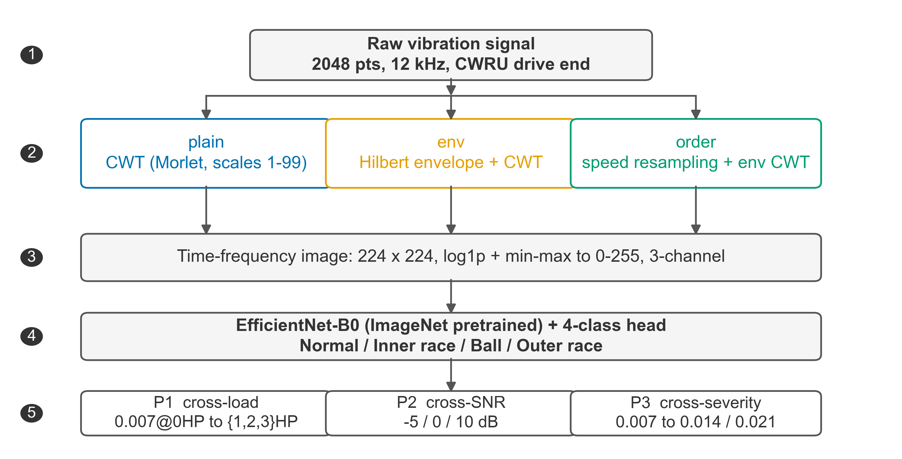
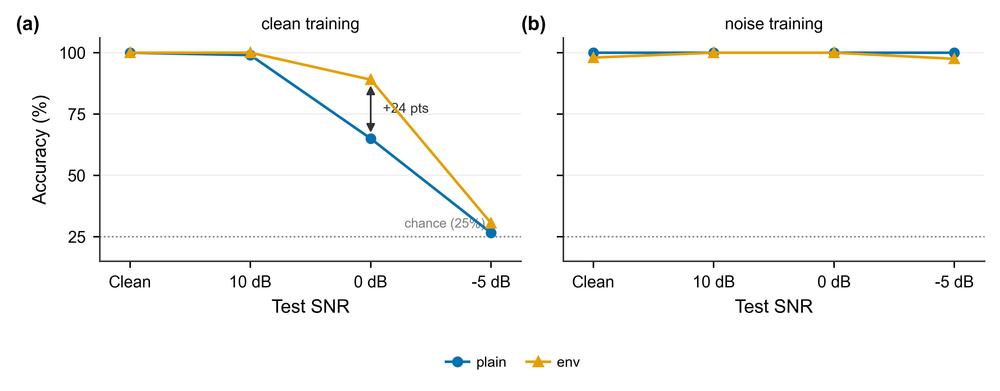
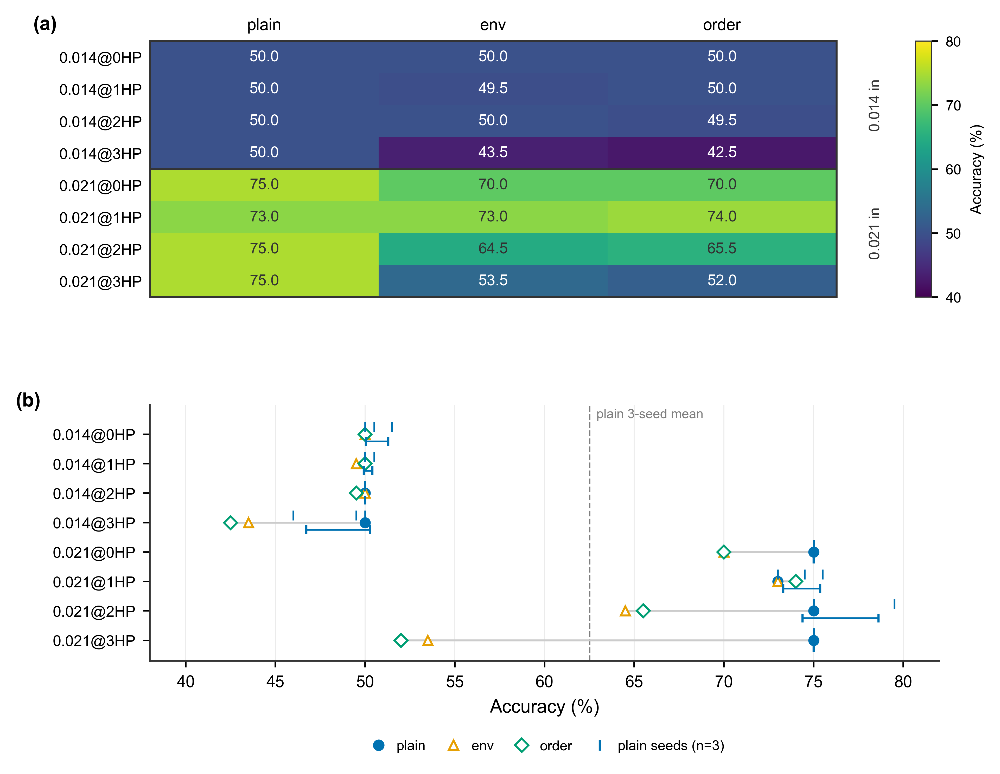
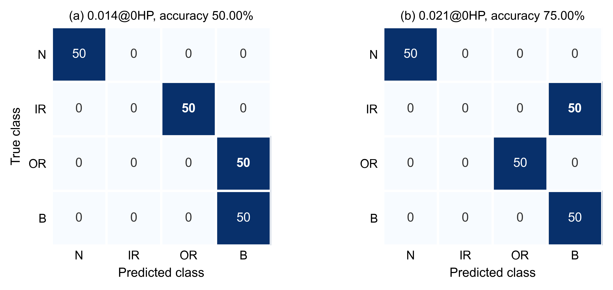
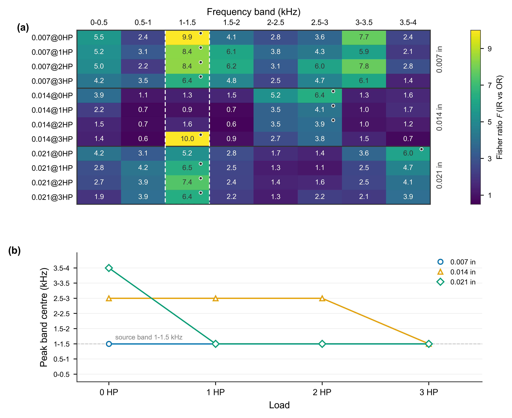
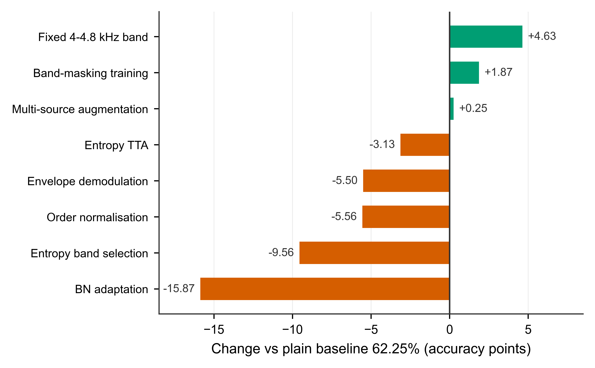
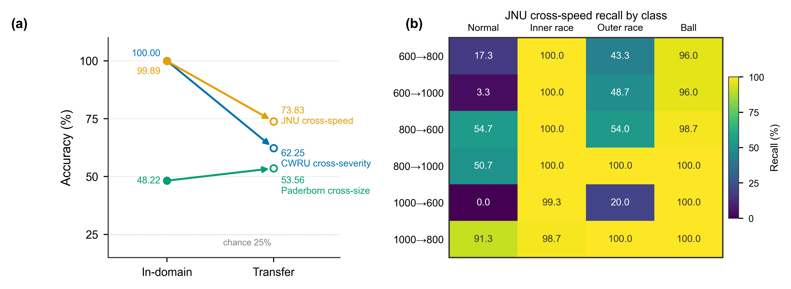

# Fault-size shift in rolling-bearing diagnosis: a controlled comparison of time–frequency representations and the limits of band-migration invariance

**Jiarui Liu**

School of Mechanical and Electrical Equipment, Linyi Campus, Qingdao University of Technology, China

Corresponding author: Jiarui Liu (e-mail: ages257@outlook.com; ORCID: 0009-0002-3035-9295).

---

## Abstract

A diagnostic model can pass every check on one operating condition and still fail without warning once the fault it learned has grown. Transfer studies almost always vary load, not damage severity. Using CWRU drive-end data, three mutually non-overlapping protocols are built—cross-load, cross-SNR and cross-severity—and three time–frequency representations are compared under one EfficientNet-B0 backbone, one hyperparameter set and one selection rule, with only the representation varying. Each CWRU damage size happens to be a separate bearing recorded independently, so severity couples size with re-mounting and re-recording; the protocol is therefore treated throughout as a severity drift rather than an isolated size effect.

Cross-load is saturated at 99.50%; order normalisation lifts the envelope representation to 100.00% there but adds nothing under severity drift (56.69% vs 56.75%). Severity drift is the hardest shift, at 62.25% (62.52% over three seeds, per-domain SD ≤ 2.12). Excluding the constructionally invariant normal class, the three-class mean is 50.03% against a 33.3% chance level. The failure is not the two race classes swapping: the inner race is never recovered, ≤ 6% recall in all eight target domains. At 0.014 in diameter both races are lost; at 0.021 in the outer race returns to 100% and inner-race windows move to the ball class. So the breakdown is one of localisation, not detection.

A Welch-Fisher analysis shows the discriminative band migrating upward at 0 HP only—1–1.5 → 2.5–3 → 3.5–4 kHz—and returning to the source band at higher loads. This makes it a load-matched signature of this particular drift, not a law of the data. Eight standard remedies fail to restore the inner/outer-race criterion. The best, a fixed 4–4.8 kHz band, reaches 67.15% but inner-race recall on 0.014 stays at 0.00%. Paderborn (48.22% same-size vs 53.56% cross-size) and JNU (73.83% cross-speed vs 99.89% in-domain) confine the effect to the single-bearing, single-record CWRU protocol.

**Keywords**: rolling bearing; fault diagnosis; time–frequency representation; domain generalisation; fault size; transfer learning

---

## 1 Introduction

Vibration-based diagnosis needs no disassembly and is sensitive, so it has become the route engineers actually use. Since the CWRU dataset was released (Case Western Reserve University, n.d.), deep-learning same-condition accuracy on it has settled at 99%–100% (Smith and Randall, 2015; Zhao et al., 2020)—for all practical purposes, saturated.

Researchers then reached for the "cross-load" protocol: train on one load, test on the others. But this carries two latent problems. First, a load change on CWRU means a speed shift of only 3.7% (1797 → 1730 r/min) and some amplitude modulation of the resonance band. The time–frequency image barely changes. Models absorb this trivial variation as an invariant feature, and metrics saturate trivially. Second, nearly every paper reports only this one shift, so the fragility of these models under other kinds of change never surfaces.

Maintenance engineers face a different shift. Defects grow progressively: at one measurement point, successive inspections see 0.007, 0.014 and 0.021 in defects. Training on early damage and deploying on later damage is the normal case, not an exotic test. This shift changes neither speed nor sensor, yet it changes impulse width, energy and resonance excitation—its mechanism has nothing to do with load shift. Studies that take fault severity as the cross-domain variable are markedly fewer.

This paper does not pursue further gains on the saturated cross-load metric. Instead it does three things: (1) builds three mutually non-overlapping, reproducible protocols with a fixed backbone, fixed hyperparameters and fixed data scale—varying only the representation; (2) compares raw CWT, envelope CWT and envelope-plus-order CWT under those protocols, and quantifies what "physical priors" actually buy you under different shift types; (3) provides baselines, confusion structure and failure-mode analysis for severity drift, and shows that this is the genuinely open problem.

## 2 Related work

### 2.1 Time–frequency-image-based diagnosis

Converting a one-dimensional vibration signal into a two-dimensional time–frequency image and feeding it to a CNN—almost always an ImageNet-pretrained ResNet or EfficientNet (He et al., 2016; Tan and Le, 2019)—is today the most mature and reproducible paradigm (Janssens et al., 2016; Wen et al., 2018; Zhang et al., 2017; Guo et al., 2019). Its advantage is simple: pretrained weights let the model converge in the small-sample regime where CWRU experiments live.

### 2.2 Physical priors in the front-end

Another line writes signal-processing operators into the network: wavelet convolution kernels, STFT filter banks, Sinc front-ends (Ravanelli and Bengio, 2018), envelope-demodulation front-ends (Antoni, 2006, 2007). Such methods usually report clear gains on a single operating condition with real industrial data. But whether those gains come from the physical prior itself, or from extra trainable parameters and a better-matched band, has never been settled by a controlled cross-domain comparison. Order analysis (Fyfe and Munck, 1997) aligns speed-dependent fault frequencies onto fixed order coordinates and is a classical tool for variable-speed conditions, but it needs a known speed. Without a tachometer the speed has to be estimated from the signal, which adds another error source.

### 2.3 Severity as a shift variable

Most transfer studies vary load, speed or sensor. Fault severity is a different axis: it changes impulse width, energy and resonance excitation while leaving speed and sensor untouched. Yet in the literature severity is usually absorbed as extra classes inside one condition, not treated as the domain variable. Paderborn (Lessmeier et al., 2016) is one of the few benchmarks with graded damage, and even there the grades are often pooled in CNN studies. Domain-generalisation surveys (Zhou et al., 2023) and the dataset-shift literature (Quiñonero-Candela et al., 2009) formalise label-preserving covariate shifts but provide no protocol where severity alone is the shift. The CWRU protocol itself has also been criticised (Smith and Randall, 2015; Zhao et al., 2020): overlapping windows and file-level splitting inflate metrics. The closest precedent is recent: transferring across CWRU damage sizes, Lee and Jung (2026) obtain 83–85% with a CNN and show that pooling severities during training can itself induce negative transfer. That establishes the phenomenon on this benchmark, but it varies the training design rather than the front-end representation, and it reports aggregate accuracy rather than per-class recall, which leaves the contribution of the constructionally invariant normal class unseparated. Work that predicts severity as a label still outnumbers work that crosses it as a domain (Chen et al., 2021; Liu et al., 2022; Weng et al., 2023). The gap addressed here is therefore concrete—a severity-only protocol, with a fixed backbone, fixed selection rule and fixed data scale, in which the time–frequency representation is the single variable.

## 3 Data and diagnostic protocols

### 3.1 Data

CWRU drive-end acceleration data (Case Western Reserve University, n.d.) at 12 kHz. Four health states: normal (N), inner-race fault (IR), ball fault (B), outer-race fault (OR, taken at the @6 o'clock position so the fault location is unambiguous). Three damage diameters: 0.007, 0.014 and 0.021 in (0.178, 0.356, 0.533 mm). CWRU specifies diameter in inches; earlier literature often mislabels these as in²—a persistent confusion that this paper avoids. Four load levels: 0/1/2/3 HP at nominal 1797/1772/1750/1730 r/min. File numbers are in Table 1.

A critical detail: **each damage size was seeded in a separate bearing and recorded independently**, with its own mounting and run-out. So a "cross-size" experiment also crosses bearing individual and recording session. Section 4.8 shows this confound is not incidental. The protocol is therefore treated throughout as severity drift—size + re-mounting + re-recording, what a maintenance engineer actually faces when a defect grows—and all mechanism statements are restricted accordingly.

Table 1 Experimental data file numbers

| Damage size | Load | Normal | Inner race | Ball | Outer race |
|---|---|---|---|---|---|
| 0.007 | 0/1/2/3 HP | 97/98/99/100 | 105/106/107/108 | 118/119/120/121 | 130/131/132/133 |
| 0.014 | 0/1/2/3 HP | 97/98/99/100 | 169/170/171/172 | 185/186/187/188 | 197/198/199/200 |
| 0.021 | 0/1/2/3 HP | 97/98/99/100 | 209/210/211/212 | 222/223/224/225 | 234/235/236/237 |

Two additional public datasets serve as external checks: **Paderborn** (Lessmeier et al., 2016)—6203 deep-groove bearings, 64 kHz, four conditions × 20 segments per bearing, grades 1–3, no ball class—and **JNU** (Wang, n.d.)—four classes including ball, 600/800/1000 rpm, 50 kHz, all defects at a single 0.3×0.05 mm level. Both reused the same backbone, hyperparameters, window length and image size without retuning, so any difference across datasets reflects only the data.

### 3.2 Sample splitting

Sliding window: 2048 points, stride 512 (75% overlap). For each domain (size × load), the first 150 windows of each class form the training partition, the last 50 the test set; inside the training partition the first 120 per class are for optimisation, the remaining 30 only to monitor convergence. The partitions are indexed non-overlapping (1–150 vs 151–200), but because stride is one quarter of window length the last training and first test window share 1536 of 2048 samples. Reported test numbers are therefore estimates, and differences below a few points are read conservatively (Section 5.3).

### 3.3 Three protocols

- **P1 Cross-load**: source 0.007@0HP, targets 0.007@{1,2,3}HP.
- **P2 Cross-SNR**: additive Gaussian white noise, SNR ∈ {−5, 0, 10} dB (power computed within each 2048-point window). Two training settings: clean training, and noise training with two noisy copies per window and SNR ~ U(−5,10) dB. Test-side noise added independently per condition with a fixed noise seed.
- **P3 Cross-severity drift**: source 0.007@0HP, targets {0.014, 0.021}@{0,1,2,3}HP, eight target domains. Size, bearing individual and recording session change together (Section 3.1).

All three protocols share backbone and hyperparameters, so any difference between two result rows is attributable to the representation alone.

### 3.4 Time–frequency representations

Three pipelines, all feeding into the same CNN:

1. **plain**: CWT of the raw signal (Morlet, scales 1–99). Magnitude taken, `log1p` compressed, min–max normalised to 0–255, bilinearly resized to 224×224, replicated from greyscale into three channels.
2. **env**: Hilbert envelope demodulation first, then the same CWT pipeline.
3. **order**: before enveloping, resample the signal by linear interpolation with `k = 1797 / rpm`, normalising speed to 1797 r/min; then envelope CWT.

### 3.5 Diagnostic model

EfficientNet-B0 (ImageNet pretrained; Tan and Le, 2019) with a four-class fully connected head. Differential learning rates (1e-4 backbone, 1e-3 head), AdamW (weight decay 1e-4), cosine annealing, 30 epochs, batch 32, seed 42. No early stopping. No best-checkpoint rollback. Every reported result is the model after the 30th epoch, and the 30 held-out windows per class never select a checkpoint or tune a hyperparameter. The same rule applies to all protocols and every remedy. Augmentation: RandomResizedCrop(224, scale=(0.85,1.0)) plus light ColorJitter. No domain-adaptation module (Ganin et al., 2016; Long et al., 2015; Sun et al., 2016a; Sun and Saenko, 2016b) is used, so any gain can come only from the representation. The complete pipeline is summarised in Figure 1.

{width=6.3in}

**Figure 1** Pipeline and experimental design. 2048-point windows (12 kHz, CWRU drive end) are mapped by one of three representations—plain CWT, Hilbert-envelope CWT or speed-normalised envelope CWT—to 224×224 images, classified by an ImageNet-pretrained EfficientNet-B0 and evaluated under P1 (cross-load), P2 (cross-SNR) and P3 (cross-severity drift).

## 4 Results

### 4.1 P1: cross-load is saturated

Table 2 Cross-load accuracy (%, source domain 0.007@0HP)

| Representation | 1HP | 2HP | 3HP | Target-domain mean |
|---|---|---|---|---|
| plain | 100.00 | 99.50 | 99.00 | **99.50** |
| env | 73.00 | 71.50 | 67.50 | **70.67** |
| order | 100.00 | 100.00 | 100.00 | **100.00** |

Cross-load barely matters here. The raw CWT stays above 99% across all three target loads; the time–frequency texture already carries everything needed. Envelope demodulation instead **degrades** performance to 70.67%—it confuses the two race classes by erasing the position of the structural resonance band, the main cue for fault location. Order normalisation lifts env from 70.67% all the way to 100.00% (+29.33 points), but this is not a universal physical gain. After enveloping, the fault frequencies fall at low frequency and expose the tiny speed shift; order normalisation removes that shift. The "order gain" is therefore a compensation for the envelope's deficiency—a finding that sets up the counter-evidence in P3.

### 4.2 P2: the training protocol decides, not the representation

Table 3 Cross-SNR accuracy (%, source domain 0.007@0HP; single seed 42)

| Representation | Training setting | Clean | 10 dB | 0 dB | −5 dB |
|---|---|---|---|---|---|
| plain | Clean training | 100.00 | 99.00 | 65.00 | 26.50 |
| env | Clean training | 100.00 | 100.00 | 89.00 | 30.50 |
| plain | Noise training U(−5,10) dB | 100.00 | 100.00 | 100.00 | 100.00 |
| env | Noise training U(−5,10) dB | 98.00 | 100.00 | 100.00 | 97.50 |

Under clean training, the envelope does show noise robustness—at 10 dB both are near full marks; at 0 dB env reaches 89.00% against 65.00% for plain, a 24-point gap. But at −5 dB both collapse together (30.50% vs 26.50%), close to the 25% chance level. Once the training distribution covers the test noise level, the difference vanishes. With noise training plain attains 100.00% in all four conditions; env is 98.00/100.00/100.00/97.50%, so plain is even marginally better.

P2 is therefore not used to rank representations—it merely shows that the training protocol decides the conclusion. The main evaluation remains P3. One detail echoes P3: at 0 dB under clean training, plain also loses the inner race completely (0.00%), whereas env retains 80.00%. Noise and severity drift are different shifts, but they trigger the same failure: the resonance band used to separate the races is destroyed.

{width=6.2in}

**Figure 2** Cross-SNR accuracy of the two representations under the two training settings (data of Table 3): (a) clean training; (b) noise training with SNR ~ U(−5,10) dB. The dotted line marks the 25% chance level.

### 4.3 P3: cross-severity drift is the open shift

Table 4 Cross-severity drift accuracy (%, source domain 0.007@0HP; rows are target domains; plain is the mean ± SD over seeds 42/123/2026, SD taken over the three seeds as a population; env and order are seed 42)

| Target domain | plain | env | order | IR recall (plain) | OR recall (plain) |
|---|---|---|---|---|---|
| 0.014@0HP | 50.67 ± 0.62 | 50.00 | 50.00 | 2.67 | 0.00 |
| 0.014@1HP | 50.17 ± 0.24 | 49.50 | 50.00 | 0.67 | 0.00 |
| 0.014@2HP | 50.00 ± 0.00 | 50.00 | 49.50 | 0.00 | 0.00 |
| 0.014@3HP | 48.50 ± 1.78 | 43.50 | 42.50 | 0.67 | 0.00 |
| 0.021@0HP | 75.00 ± 0.00 | 70.00 | 70.00 | 0.00 | 100.00 |
| 0.021@1HP | 74.33 ± 1.03 | 73.00 | 74.00 | 1.33 | 100.00 |
| 0.021@2HP | 76.50 ± 2.12 | 64.50 | 65.50 | 6.00 | 100.00 |
| 0.021@3HP | 75.00 ± 0.00 | 53.50 | 52.00 | 0.00 | 100.00 |
| Mean | **62.52** | **56.75** | **56.69** | — | — |

The largest per-domain SD is 2.12 points—this is not a seed accident. The two recall columns settle a central question: **the inner race is essentially never recovered** (0.00–6.00%, group means 1.00 and 1.83), whereas the **outer race is completely lost at 0.014 and completely recovered at 0.021** (0.00 vs 100.00). So this is not "the two race classes swapping." One is lost under both shifts; the other only under the milder one.

One property of the benchmark inflates these four-class numbers: the normal class is the same record (files 97/98/99/100) in every domain, so its 100% recall is guaranteed by construction and contributes a fixed 25 points to every cell. Excluding it, the three-class mean is **50.03%** (per domain: 34.23, 33.56, 33.33, 31.33, 66.67, 65.77, 68.67, 66.67)—against a 33.3% chance level. The 0.014 domains are barely above chance; the 0.021 domains are around twice chance.

Because size, bearing and recording change together, the observations below describe the composite severity drift; any attribution to size alone is a working hypothesis.

**First**, order normalisation adds nothing on top of the envelope: 56.69% vs 56.75%, well below the 2.12 per-domain SD, and both sit about 5.5 points below plain. Size changes temporal width and resonance excitation of the impulses, not the position of characteristic frequencies on the Hz axis—and order normalisation corrects only the latter. This is a direct counterexample to the claim that order analysis is a universal solution for variable conditions.

**Second**, plain is best, and its advantage comes entirely from the 0.021 targets (74.50 vs 65.25 for env and 65.38 for order), whereas at 0.014 all three collapse to chance (42.50–50.00).

**Third**, a larger span is easier. 0.021, two grades away, is easier than 0.014, one grade away. The difference between 0.014 and 0.007 is neither large nor small—insufficient to form a new class, yet sufficient to destroy the learned criterion—whereas 0.021 impulses form a clearly separable pattern.

**Fourth**, the representation decides which race class survives. At 0.021 plain recovers the outer race (100%) and loses the inner one (0%); env and order keep partial inner-race recall but lose the outer race completely.

{width=6.4in}

**Figure 3** Cross-severity drift results. (a) Accuracy of the three representations on the eight target domains (seed 42) on one shared colour scale; the bold plain column is the three-seed protocol summarised by its seed-42 run. (b) Dumbbell plot of the same data: the three representations per domain are connected by their range, and plain additionally shows the three individual seeds (ticks) with mean ± SD (error bar).

### 4.4 Failure mode: the inner race is never recovered, its destination changes

Figure 4 shows the failure structure of two representative target domains (plain, source 0.007@0HP; numeric matrices in Table S1). At 0.014@0HP, accuracy 50.00%: all 50 inner-race windows are read as outer race; all 50 outer-race windows as ball. At 0.021@0HP, accuracy 75.00%: all 50 inner-race windows go to ball, outer race is fully recovered, normal and ball stay intact.

The collapse is not general: the evidence used to *localise* a fault collapses. The inner race never comes back, and only where it goes changes—outer race at 0.014, ball at 0.021. Every error therefore stays inside the fault classes: defective windows are never declared healthy at 0 HP, but the evidence separating the two bearing positions is gone. Inner-race windows get relabelled as another fault location. In maintenance this misdirects inspection—a growing inner-race defect is reported as a ball or outer-race defect—but it is a localisation failure, not a missed detection.

{width=6.1in}

**Figure 4** Confusion matrices of the plain representation on 0.014@0HP (a) and 0.021@0HP (b); rows are true classes, columns predicted classes (50 test windows per class; numeric matrices in Table S1). All 50 inner-race windows go to outer race at 0.014 and to ball at 0.021, so the race is lost in both domains and only its destination changes; at 0.014 the outer-race class is also read entirely as ball,.

### 4.5 Mechanism: the separable band migrates with severity at 0 HP

A Welch log-power spectrum was computed per window, and the Fisher discriminant ratio between the inner and outer races was evaluated per band as `F = (m_IR − m_OR)² / (v_IR + v_OR)` over the 12 size–load domains (full matrix in Table S2, mapped in Figure 5a).

At 0 HP the source band behaves as expected. The 0.007 data concentrate their inter-race discriminability in **1–1.5 kHz** (F = 9.94), and this concentration survives all four source-size loads (6.44–9.94). When size changes at fixed load, the peak leaves that band: 0.014@0HP falls to F = 1.33 there and peaks at 2.5–3 kHz (6.37); 0.021@0HP peaks at 3.5–4 kHz (5.96). This is the observation on which Section 4.4 rests: a model trained to read the 1–1.5 kHz texture of the source domain sees a nearly empty band at 0.014@0HP.

But the full table also falsifies a stronger claim. If discriminability migrated upward unconditionally, every 0.014 target would peak at 2.5–3 kHz and every 0.021 target at 3.5–4 kHz. It does not. 0.014 at 1 HP and 2 HP peak at 2.5–3 kHz, but 0.014@3HP returns to 1–1.5 kHz (9.96). And every 0.021 target except 0 HP peaks at 1–1.5 kHz (6.38–7.41). The migration is therefore **load-matched**, not a law of the data. A size-driven migration and a load-driven re-concentration coexist. The mechanism explains the 0 HP failures but is not an a priori band rule.

This account is consistent with everything above. The source model reads the 1–1.5 kHz texture, which is nearly empty at 0.014@0HP, so inner-race windows are predicted as outer race. Envelope demodulation erases band position and fails under cross-load. Order normalisation corrects only frequency position and gives zero gain. Multi-source augmentation reinforces the wrong band. At 0.021@1/2/3HP, where the peak returns to the source band, the model still fails—so within-band statistics matter as well as band position.

{width=6.4in}

**Figure 5** Band-wise inner/outer-race Fisher discriminant ratio on all 12 size–load domains. (a) Heat map of Table S2, rows grouped by damage size, the peak band of each row marked with a dot and the source band (1–1.5 kHz) outlined with a dashed box. (b) Peak band versus load for the three damage sizes: the upward migration appears at 0 HP only (1–1.5 → 2.5–3 → 3.5–4 kHz), while at 1–3 HP the 0.021 targets and 0.014@3HP return to the source band (dashed line).

### 4.6 Eight standard remedies neither repair nor explain the failure

Table 5 Remedies against severity drift (mean over the eight target domains, source 0.007@0HP)

| Remedy | Target-domain mean | Change vs plain (62.25) | Conclusion |
|---|---|---|---|
| plain (baseline) | 62.25 | — | — |
| Envelope demodulation (env) | 56.75 | −5.50 | harmful |
| Order normalisation (order) | 56.69 | −5.56 | no gain over env |
| Multi-source augmentation (0.007+0.014) | 62.50 | +0.25 | 12 points below single-source 0.007→0.021 (74.50) |
| Test-time adaptation (entropy (Wang et al., 2021) / BN (Schneider et al., 2020)) | 59.12 / 46.38 | −3.13 / −15.87 | ineffective / harmful |
| Band-masking training | 64.12 | +1.87 | repairs IR recall only at 0.021 |
| Adaptive band selection (entropy criterion) | 52.69 | −9.56 | "confident" is not "correct" (Section 4.7) |
| Fixed 4–4.8 kHz band (3 seeds) | 67.15 | +4.63 | partial; IR recall at 0.014 still 0 |

**None of the eight remedies repairs the inner/outer-race criterion on the 0.014 target domain.** That is the most important negative result of this paper. The only oracle yielding a two-digit gain (+11.56) uses target labels and is not a usable method. Five remedies are harmful. Three give small gains (+0.25, +1.87, +4.63). Figure 6 ranks them by their change relative to plain.

A head-capacity check is reported separately in Table S6: enlarging the classifier (MLP or KAN, ~100k parameters; Liu et al., 2024) lowers cross-load accuracy to 45.33% and 56.83% against 70.67% for the 5k-parameter linear head, so capacity is not the limiting factor.

{width=5.4in}

**Figure 6** Accuracy change of each remedy relative to the plain baseline (62.25%) on the cross-severity protocol, as a diverging bar chart (green: gains; vermillion: losses); the 3-seed fixed-band remedy is compared with the 3-seed baseline (62.52%).

### 4.7 Band selection: discriminability and transferability are different attributes

Section 4.5 shows that the discriminative information migrates across severity drift, so the natural remedy is automatic band selection. One source-domain model was trained for each of eight band representations (the full band plus seven candidates, band-pass filtered before the CWT with the rest unchanged) and three selection schemes were compared over the eight target domains (seed 42): full-band baseline reaches 62.25%, unsupervised entropy minimisation 52.69% (−9.56), entropy selection with a non-degenerate constraint 65.12% (+2.88), and an oracle chosen by target accuracy 73.81% (+11.56, an upper bound).

The unsupervised entropy criterion fails clearly. In severity drift, a model's confidence and its correctness do not coincide—it predicts inner-race windows as outer race with high confidence, and low entropy corresponds precisely to this consistent error (the same origin as the harmful entropy-minimising TTA of Section 4.6). Adding the non-degenerate constraint yields only +2.88, insufficient to constitute a method. The oracle, however, points to the same band **4–4.8 kHz** in six of eight target domains—a high-frequency range independent of damage size. "Fixing this band without any selection" was therefore examined (Table 6).

Table 6 Severity-drift results with a fixed 4–4.8 kHz band (3 seeds, mean ± SD, %)

| Target domain | Accuracy | Inner-race recall |
|---|---|---|
| 0.014@0HP | 70.00 ± 2.12 | 0.00 ± 0.00 |
| 0.014@1HP | 57.33 ± 1.70 | 0.00 ± 0.00 |
| 0.014@2HP | 52.50 ± 1.63 | 0.00 ± 0.00 |
| 0.014@3HP | 54.17 ± 3.09 | 0.00 ± 0.00 |
| 0.021@0HP | 81.67 ± 6.28 | 34.00 ± 24.06 |
| 0.021@1HP | 57.00 ± 7.95 | 61.33 ± 27.82 |
| 0.021@2HP | 84.67 ± 4.09 | 87.33 ± 9.98 |
| 0.021@3HP | 79.83 ± 3.79 | 83.33 ± 11.81 |
| Overall mean | **67.15** | — |

The mean is 67.15%, 4.63 points above the three-seed full-band baseline (62.52%), and **no target-domain label is used**. Two limitations should be stated together. The fluctuation across seeds increases markedly—up to ±7.95 on 0.021@1HP, against ≤2.12 for the full-band baseline—so the benefit is not stable. And inner-race recall on 0.014 stays at 0.00 ± 0.00. The gain comes mainly from correct discrimination of the outer-race and ball classes. **The inter-race criterion is not repaired.**

Placing Table 6 beside the per-band Fisher values (Table S2, one estimator throughout) yields the most tension-laden conclusion of this paper: **discriminability and transferability are two different attributes, and here they point in opposite directions**. At 0.014@0HP the most discriminable band is 2.5–3 kHz (F = 6.37), yet as a representation it gives only 47.50% (seed 42). The high band chosen by the oracle is not the peak of any 0.014 domain—the adjacent 3.5–4 kHz column holds F = 1.55 there—yet it gives 70.00 ± 2.12% over three seeds. The Fisher ratio measures separability within one record per class. Severity drift moves the peak out of the original band, so a band that is merely stable across domains remains usable after transfer even without a peak.

### 4.8 Paderborn: the cross-size degradation is not reproduced

To test whether the mechanism is general or CWRU-specific, the same protocol was applied to Paderborn (6203 bearings, 64 kHz, 4 s per segment): the pipeline of Section 3, three classes (normal / inner / outer), three seeds, and the fixed condition N15_M07_F10 (1500 rpm / 0.7 Nm / 10 kN) with 20 segments per bearing.

To avoid conflating a change of bearing with a change of size, a same-size control was added: grade 1 trained on KI01/KI03 and KA01/KA05 and tested on the other grade 1 bearings KI05 and KA07. The cross-size group was tested on grade 2 bearings KI07/KI08 and KA03/KA06/KA09. The healthy class of both groups was tested on K003, excluded from training. Each class uses 150 optimisation, 50 validation and 50 test windows—the same test size as CWRU, but 25% more optimisation windows.

Table 7 Same-size vs cross-size transfer on Paderborn (3 seeds, mean ± SD, %)

| Test group | Accuracy | Normal recall | Inner-race recall | Outer-race recall |
|---|---|---|---|---|
| A same size (grade 1 → other grade 1 bearings) | 48.22 ± 6.91 | 100.00 ± 0.00 | 0.00 ± 0.00 | 44.67 ± 20.74 |
| B cross-size (grade 1 → grade 2) | 53.56 ± 3.62 | 100.00 ± 0.00 | 40.67 ± 6.80 | 20.00 ± 4.32 |

**Cross-size does not degrade at all; it is on average 5.34 points higher than same size.** That difference is smaller than either seed SD (6.91 / 3.62) and, with no formal test (Section 5.3), is not interpreted as an improvement. More critically, the failure modes point in opposite directions: the stable "inner-race recall identically zero" seen on CWRU appears on Paderborn in the **same-size** group, while the cross-size group has 40.67% instead.

As a diagnostic control, a **within-bearing** time-segment split (first 15 segments of K001/KI01/KA01 for training, last 5 of the same bearings for testing, seed 42) yielded **100.00%** with all three recalls at 100%. This rules out the explanation that the representation cannot separate the races: on the same physical bearing the representation is perfectly separable, and the drop to 48%–54% is caused by the **cross-bearing** setting alone. The two rows of Table 7 therefore do not show a weaker CWRU effect; they show that the cross-size effect does not appear at all under multi-bearing conditions.

**The Fisher magnitude on Paderborn is two orders lower than on CWRU** (0.01–0.10 vs 0.6–10; Table S3)—a protocol rather than implementation difference. Each CWRU class is a single record, so variance comes only from window position; each Paderborn class spans 2–3 bearings, where per-bearing variability drowns the spectral-shape differences caused by damage type. The sharp separable bands of Section 4.5 have no measurable counterpart here, and the migration does not appear in relative shape either: grade 1 peaks at 3.0–3.5 kHz whereas grade 2 peaks at 1.0–1.5 kHz. Accordingly, **the band migration is a phenomenon of the CWRU single-bearing protocol and cannot be extrapolated into a general mechanism**. Under multi-bearing conditions, per-bearing variability is a stronger shift source than damage size—which also explains why the same-size group reaches only 48.22% while the literature often reports >95% under random within-domain splits.

Several limits apply: no ball class, grade 3 contains only KI16, each grade has 2–3 bearings and the A/B groups 1–3, and grade 1 and grade 2 come from different batches. So size and bearing individual cannot be fully separated. A definitive test would need graded damage on one bearing of one batch, which no public dataset provides.

### 4.9 JNU: cross-speed degradation is severe, with a different failure mode

The third dataset is JNU: four classes (normal / inner / outer / ball), three speeds (600/800/1000 rpm), 50 kHz, all defects uniformly 0.3×0.05 mm wire-cut at a single level. JNU therefore has **no damage-size variable** and cannot verify the severity-drift mechanism. It contributes two points: the class count matches the main protocol, and cross-speed (600→1000 rpm) is a far stronger shift than the 3.7% cross-load of CWRU.

The protocol matches the preceding datasets (S7), with 4-fold decimation to 12.5 kHz. For each speed and class, the first 150 windows trained, the next 50 validated, the last 50 tested, with no temporal overlap between training and test. One speed is the source, the same speed the in-domain bound, the other two the cross-speed targets.

Table 8 JNU cross-speed transfer (3 seeds, mean ± SD, %)

| Source | Same speed (in-domain) | →600 rpm | →800 rpm | →1000 rpm | Cross-speed mean |
|---|---|---|---|---|---|
| 600 rpm | 99.67 ± 0.24 | — | 64.17 ± 5.20 | 62.00 ± 6.16 | **63.08** |
| 800 rpm | 100.00 ± 0.00 | 76.83 ± 4.50 | — | 87.67 ± 1.84 | **82.25** |
| 1000 rpm | 100.00 ± 0.00 | 54.83 ± 2.95 | 97.50 ± 0.82 | — | **76.17** |

The mean over the six transfer tasks is **73.83%** against an in-domain bound of 99.67%–100.00%. First, **cross-speed is a real and severe shift**, in contrast with the saturation of CWRU cross-load: 99.50% there against 54.83% at the worst here. Cross-load saturates in Section 4.1 not because the model is strong but because the shift itself is too small. Once speed varies by tens of percent the time–frequency texture loses its invariance.

Second, **the failure mode differs completely and points the other way**. On CWRU the errors are almost all "inner race predicted as outer race" with inner recall identically zero. On JNU it is precisely the **inner race that is most stable** (recall 98.67%–100.00%) and the **normal class that collapses** (Table S4). A speed change moves the impulse repetition frequency and the resonance excitation. The normal class has no impulse sequence to anchor to, so it is the most easily attracted to a neighbouring fault class.

Table S4 also reveals a **speed-distance effect**. The two tasks 800↔1000, which do not involve 600 rpm, reach 87.67% and 97.50%, whereas the four tasks involving 600 rpm fall within 54.83%–76.83% and give a normal recall of 0.00%–54.67% when 600 rpm is the target. Transfer is also asymmetric (e.g. 64.17% for 600→800 against 76.83% for 800→600), so the three speeds are not equidistant re-recordings on one rig, and the 600 rpm record is closer to an outlier domain.

The Fisher analysis (Table S5) adds two points. The magnitude is again 1–2 orders lower than on CWRU (peak F 0.22–0.49), confirming that the sharp severity-migrating band of Section 4.5 depends on "one record per class". And the peak band *does* move upward with speed: the inner/outer-race pair peaks at 1.0–1.5 kHz at 600 rpm and at 4.0–4.5 kHz at 800 and 1000 rpm. Band migration can therefore be driven by the operating condition rather than by damage size, with the same consequence that the source-domain band fails in the target. The hypothesis of "a fixed optimal band across conditions" does not hold on JNU either.

Each class × speed of JNU is **one record**, the normal records are 30 s and the fault records 10 s, and the defect size is fixed. Table 8 therefore combines speed with recording differences rather than isolating a pure speed effect.

**Cross-speed degradation is thus reproduced on JNU (73.83% vs an in-domain 99.89%), but its failure mode, magnitude and driving factor all differ from the CWRU severity-drift results.** Combined with Section 4.8, the CWRU mechanism is confined to "single bearing, single record, size as the only variable".

{width=6.4in}

**Figure 7** External validation on the three public datasets. (a) Slope chart of in-domain (or same-condition) versus transfer accuracy: CWRU cross-severity 100.00% → 62.25% (−37.75 points), Paderborn cross-bearing 48.22% → 53.56% (+5.34), JNU cross-speed 99.89% → 73.83% (−26.06). (b) Per-class recall of the six JNU cross-speed tasks; the collapse is concentrated in the normal and outer-race classes rather than in the inner/outer-race pair, i.e. the CWRU failure mode is not reproduced.

## 5 Discussion

### 5.1 Why the physical priors do not pay off here

CWRU is single-bearing test-rig data at approximately constant speed, with a stable resonance band and high SNR. The raw CWT already retains the broadband resonance information and is sufficient. Demodulation loses discriminative information. Gain-type priors—wavelet convolution, learnable filter banks—act closer to "parameter capacity + band selection", which is not necessarily positive across domains. Claiming a gain for physical priors on CWRU therefore requires strictly aligned controls. This paper's controlled comparison suggests that such controls are rarely present in the studies cited here.

### 5.2 Why severity drift is difficult

Damage size changes the morphological parameters of the impulse sequence—pulse width, amplitude envelope, resonance decay constant—not merely energy. On the time–frequency image this appears as a change in texture thickness and contrast rather than a vertical translation, and it is not removable by simple normalisation. Section 4.7 further shows that size variation **changes the carrier band**: the band with strongest in-source discriminability (2.5–3 kHz for 0.014) is precisely the size-sensitive band and collapses after transfer, whereas 4–4.8 kHz stays moderately discriminative over all sizes. Band selection should therefore consider a band's stability across sizes, not just its separability under the current condition.

### 5.3 Limitations

1. External validity rests on two datasets. On Paderborn (Section 4.8) same-size (48.22%) does not differ from cross-size (53.56%) by more than either seed SD; on JNU (Section 4.9) cross-speed degradation is severe but the failure switches to normal-class collapse. JNU has no size levels and one record per class × speed, so speed and recording batch cannot be separated. The boundary is "single bearing, single record, size as the only variable".
2. Coverage is partial: other size levels (e.g. 0.028 in) are not tested, the cross-severity result uses three seeds against one elsewhere, the multi-source setting tests only "0.007+0.014 → 0.021", and the fixed-band benefit fluctuates strongly across seeds (worst 57.00 ± 7.95) and is unverified with more seeds.
3. Adjacent train/test windows share 1536 samples, so the split is not strictly non-overlapping; differences below a few points are read conservatively.
4. Only 0.007@0HP is used as source and only EfficientNet-B0, so the ordering of representations and the failure modes are not checked across backbones or sources. The conclusions are therefore comparisons within one aligned configuration—what changes when only the representation changes.
5. The envelope is taken from the broadband signal without kurtogram band-pass selection, and per-image min–max normalisation removes the absolute energy scale that size partly changes; band-pass envelope and global-scale variants are planned.
6. No formal statistical test is applied. Because test windows are temporally adjacent, a cluster bootstrap or paired test on per-window predictions is needed for confidence intervals.

## 6 Conclusion

With CWRU as the object and a strictly aligned training configuration, this paper compared three domain-shift protocols and three time–frequency representations. Five conclusions emerge.

**Cross-load is saturated and cannot evidence methodological value.** The raw CWT reaches 99.50%, whereas envelope enhancement drops to 70.67%. Any "gain" reported on cross-load is likely a measurement of how well the method absorbs the trivial load shift, not how well it generalises.

**The benefit of order normalisation is conditional.** It lifts the envelope from 70.67% to 100.00% on cross-load but adds nothing under severity drift (56.69% vs 56.75%), both 5.5 points below plain; it corrects frequency shift only.

**Severity drift is the hardest and least studied shift.** The baseline is 62.25% (62.52% over three seeds; 50.03% over the three drifting classes, against 33.3% chance). The inner race is never recovered; at 0.014 both races are lost, at 0.021 the outer race returns and inner-race windows move to the ball class. All errors stay inside the fault classes, so localisation, not detection, fails. Because each CWRU size is a separate bearing and recording, the effect is a property of this single-bearing protocol and is not attributed to size alone.

**No standard remedy restores the lost class.** Of eight remedies, five are harmful, three give small gains (+0.25, +1.87, +4.63), and none restores inner-race recall on 0.014. The largest (67.15%) reallocates accuracy rather than repairing the criterion.

**Discriminability and transferability are different attributes.** The discriminability-peak band fails on transfer, whereas a drift-insensitive high band has no peak in the 0.014 domains yet remains usable. The band that separates classes best on one record is not the band that transfers best across recordings.

A defensible next step is a same-bearing severity protocol—graded damage on one bearing of one batch—which no public dataset provides. Until such data exist, the band-migration analysis of Section 4.5 should be read as a protocol-specific diagnostic rather than a general mechanism.

---

## Declarations

**Funding:** This research received no specific grant from any funding agency in the public, commercial, or not-for-profit sectors.

**Conflict of interest:** The author declares no potential conflicts of interest with respect to the research, authorship, and/or publication of this article.

**Data availability:** The CWRU, Paderborn and JNU datasets are publicly available from the sources cited in Section 3.1. The window-level split construction, evaluation scripts and per-run result files that support the findings are openly available at https://github.com/liu-4564/jvc-fault-size-shift, and will be archived on Zenodo with a DOI upon acceptance. Trained model weights are available from the corresponding author on reasonable request.

**Ethics:** Not applicable; the study uses publicly available benchmark data and involves no human participants or animals.

---

## References

Antoni J (2006) The spectral kurtosis: a useful tool for characterising non-stationary signals. *Mechanical Systems and Signal Processing* 20(2): 282–307.

Antoni J (2007) Fast computation of the kurtogram for the detection of transient faults. *Mechanical Systems and Signal Processing* 21(1): 108–124.

Case Western Reserve University (n.d.) *Bearing Data Center*. Available at: https://engineering.case.edu/bearingdatacenter (accessed 20 October 2026).

Chen Z, Huang R, Liao Y, Li J, Jin G and Li W (2021) Simultaneous fault type and severity identification using a two-branch domain adaptation network. *Measurement Science and Technology* 32(9): 094014.

Fyfe KR and Munck EDS (1997) Analysis of computed order tracking. *Mechanical Systems and Signal Processing* 11(2): 187–205.

Ganin Y, Ustinova E, Ajakan H, et al. (2016) Domain-adversarial training of neural networks. *Journal of Machine Learning Research* 17(59): 1–35.

Guo L, Lei Y, Xing S, Chen T and Li N (2019) Deep convolutional transfer learning network: a new method for intelligent fault diagnosis of machines with unlabeled data. *IEEE Transactions on Industrial Electronics* 66(9): 7316–7325.

He K, Zhang X, Ren S and Sun J (2016) Deep residual learning for image recognition. In: *Proceedings of the IEEE Conference on Computer Vision and Pattern Recognition (CVPR)*. Las Vegas, NV, pp. 770–778.

Janssens O, Slavkovikj V, Vervisch B, et al. (2016) Convolutional neural network based fault detection for rotating machinery. *Journal of Sound and Vibration* 377: 331–345.

Lee J and Jung NH (2026) Cross-fault-size generalization in bearing fault diagnosis: analysis of negative transfer phenomenon. *Transactions of the Korean Society for Noise and Vibration Engineering* 36(2): 178–186.

Lessmeier C, Kimotho JK, Zimmer D and Sextro W (2016) Condition monitoring of bearing damage in electromechanical drive systems by using motor current signals of electric motors: a benchmark data set for data-driven classification. In: *Proceedings of the European Conference of the Prognostics and Health Management Society (PHME)*. Prague, vol. 3, no. 1.

Liu D, Cui L, Cheng W, Zhao D and Wen W (2022) Rolling bearing fault severity recognition via data mining integrated with convolutional neural network. *IEEE Sensors Journal* 22(6): 5768–5777.

Liu Z, Wang Y, Vaidya S, et al. (2024) KAN: Kolmogorov–Arnold networks. arXiv:2404.19756.

Long M, Cao Y, Wang J and Jordan MI (2015) Learning transferable features with deep adaptation networks. In: *Proceedings of the International Conference on Machine Learning (ICML)*. Lille, pp. 97–105.

Quiñonero-Candela J, Sugiyama M, Schwaighofer A and Lawrence ND (2009) *Dataset Shift in Machine Learning*. Cambridge, MA: MIT Press.

Ravanelli M and Bengio Y (2018) Speaker recognition from raw waveform with SincNet. In: *Proceedings of the IEEE Spoken Language Technology Workshop (SLT)*. Athens, pp. 1021–1028.

Schneider S, Rusak E, Letzner J, et al. (2020) Improving robustness against common corruptions by covariate shift adaptation. In: *Advances in Neural Information Processing Systems (NeurIPS)*, vol. 33.

Smith WA and Randall RB (2015) Rolling element bearing diagnostics using the Case Western Reserve University data: a benchmark study. *Mechanical Systems and Signal Processing* 64–65: 100–131.

Sun B and Saenko K (2016b) Deep CORAL: correlation alignment for deep domain adaptation. In: *Proceedings of the ECCV Workshops*. Amsterdam, pp. 443–450.

Sun B, Feng J and Saenko K (2016a) Return of frustratingly easy domain adaptation. In: *Proceedings of the AAAI Conference on Artificial Intelligence*. Phoenix, AZ, pp. 2058–2065.

Tan M and Le QV (2019) EfficientNet: rethinking model scaling for convolutional neural networks. In: *Proceedings of the International Conference on Machine Learning (ICML)*. Long Beach, CA, pp. 6105–6114.

Wang C (n.d.) *JNU-Bearing-Dataset*. GitHub. Available at: https://github.com/ClarkGableWang/JNU-Bearing-Dataset (accessed 20 October 2026).

Wang D, Shelhamer E, Liu S, Olshausen B and Darrell T (2021) Tent: fully test-time adaptation by entropy minimization. In: *Proceedings of the International Conference on Learning Representations (ICLR)*.

Wen L, Li X, Gao L and Zhang Y (2018) A new convolutional neural network-based data-driven fault diagnosis method. *IEEE Transactions on Industrial Electronics* 65(7): 5990–5998.

Weng C, Lu B, Gu Q and Zhao X (2023) A novel hierarchical transferable network for rolling bearing fault diagnosis under variable working conditions. *Nonlinear Dynamics* 111(12): 11315–11334.

Zhang W, Peng G, Li C, Chen Y and Zhang Z (2017) A new deep learning model for fault diagnosis with good anti-noise and domain adaptation ability on raw vibration signals. *Sensors* 17(2): 425.

Zhao Z, Li T, Wu J, et al. (2020) Deep learning algorithms for rotating machinery intelligent diagnosis: an open source benchmark study. *ISA Transactions* 107: 224–255.

Zhou K, Liu Z, Qiao Y, Xiang T and Loy CC (2023) Domain generalization: a survey. *IEEE Transactions on Pattern Analysis and Machine Intelligence* 45(4): 4396–4415.

---

## Supplemental material

The supplemental material contains: the numeric confusion matrices of both representative target domains (Table S1); the full 12-domain band-wise Fisher matrix computed with a single estimator (Table S2); the Paderborn band-wise Fisher matrix (Table S3); the per-class recall of the six JNU tasks (Table S4); the JNU peak-band table (Table S5); the classification-head capacity check with MLP and KAN heads (Table S6); and the complete protocol and hyperparameter listing (S7) together with the reproducibility notes (S8). It is intended for online-only publication and is referred to at the corresponding points in the text.
